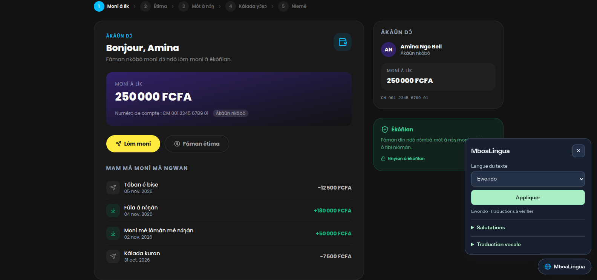

# MboaLingua

**Extension de traduction pour le simulateur SAFINUM Pay**

Guide d’évaluation · SAFINUM Innovate 2026 · Extension v0.4.1

[Guide PDF du jury](docs/MboaLingua-Guide-du-jury.pdf) · [Simulateur SAFINUM](https://safinum.cm/hackathon-test) · [Captures d’écran](screenshots/README.md) · [Documentation technique (PDF)](docs/MboaLingua-Documentation-SAFINUM.pdf)

MboaLingua traduit les libellés reconnus d’un parcours financier et permet d’écouter des phrases enregistrées.



## Installer l’extension

1. Ouvrir le dossier du projet sur l’ordinateur. Si vous avez reçu le ZIP de l’extension, le décompresser.
2. Dans Chrome, ouvrir `chrome://extensions`. Dans Edge, ouvrir `edge://extensions`.
3. Activer **Mode développeur**, puis cliquer sur **Charger l’extension non empaquetée**. Sélectionner [`apps/extension`](apps/extension/) dans le projet, ou le dossier extrait qui contient directement `manifest.json`.
4. Ouvrir le [simulateur SAFINUM Pay](https://safinum.cm/hackathon-test). Si la page était déjà ouverte, l’actualiser. Le bouton **MboaLingua** apparaît en bas à droite.

Le parcours SAFINUM se teste dans le navigateur, sans serveur local ni clé API. Utiliser les données fictives du simulateur pour tout le parcours.

## Parcours principal · Virement simulé

| Étape | Action | Résultat à vérifier |
| --- | --- | --- |
| **1. Traduire** | Ouvrir **MboaLingua**, choisir **Ewondo** dans **Langue du texte**, puis cliquer sur **Appliquer**. | Les libellés reconnus changent. Comparer le solde avec l’écran d’origine. |
| **2. Saisir** | Fermer le panneau. Cliquer sur le bouton jaune du virement, saisir **25 000 FCFA** et poursuivre jusqu’au bénéficiaire. | Les étapes suivantes affichent les traductions disponibles. La saisie, les montants et les données du bénéficiaire sont conservés par l’extension. |
| **3. Vérifier** | Utiliser un bénéficiaire fictif, puis vérifier le récapitulatif avant de confirmer la simulation. | Comparer le montant, les frais, le total, le bénéficiaire et la référence entre les écrans du récapitulatif et de la confirmation. Les frais peuvent évoluer lors de la simulation. |
| **4. Changer de langue** | Essayer **English**, puis sélectionner **Texte original** et cliquer sur **Appliquer**. | Les libellés reconnus passent en anglais, puis le texte d’origine revient. |

Les [captures commentées](screenshots/README.md) suivent ce parcours de l’écran d’accueil jusqu’à la confirmation.

## Salutations et voix

- **Salutations** — Appliquer une langue, puis ouvrir **Salutations**. Le panneau affiche quatre formules pour le matin, l’après-midi, le soir et la nuit, dans les 11 langues proposées.
- **Traduction vocale** — Ouvrir la section du même nom, choisir **Ewondo**, puis **Bonjour, comment puis-je vous aider ?** et cliquer sur **Écouter**. Le lecteur affiche la phrase source du clip.
- **Couverture** — Les libellés financiers couvrent le français, l’anglais, le basaa, le bulu, le duala, l’ewondo, le fulfulde, le ghomala, le pidgin camerounais et le yemba. Le lamnso apporte des salutations écrites et un clip. Le catalogue contient **88 enregistrements** étiquetés ewondo (42), fulfulde (45) et lamnso (1). Trois clips de synthèse sont également disponibles, dont un en ghomala.

La traduction repose sur les libellés et modèles inclus. Les libellés inconnus restent dans leur langue d’origine. Les voix sont des clips de phrases fixes. Les traductions et les enregistrements restent à valider avec des locuteurs.

## Test complémentaire · Kalaba Money

Depuis le dossier qui contient `manifest.json`, lancer ce serveur avec Python 3.

```sh
python3 -m http.server 8000 --bind 127.0.0.1
```

Ouvrir [Kalaba Money](http://127.0.0.1:8000/demo/) dans le navigateur où l’extension est chargée.

| Cas | À vérifier |
| --- | --- |
| **Accueil vocal** en **Ewondo** | Cliquer sur **Écouter l’enregistrement** dans la carte. |
| **Alerte arnaque** en **Ghomala** | Cliquer sur **Écouter la synthèse**. |
| **Paiement reçu** en **English** | Comparer le nom, la date, le montant et le nouveau solde avec le message source. |
| **Transfert annulé** en **Basaa** | Vérifier que la traduction apparaît sous le message original. |


## Dépannage

- **Le bouton est absent** — Vérifier que l’extension est activée, puis actualiser le simulateur. Pour Kalaba, utiliser le port **8000** et le chemin **/demo/**.
- **La langue semble inchangée** — Cliquer sur **Appliquer** après la sélection. Comparer les libellés de compte ou de virement. Les noms propres et certaines chaînes restent tels quels.
- **Le son ne démarre pas** — Utiliser le bouton lecture du lecteur, puis vérifier que l’onglet et la sortie audio sont actifs.

## Dossiers du projet

| Dossier | Contenu |
| --- | --- |
| [`apps/extension`](apps/extension/) | Extension, démo Kalaba, dictionnaires et audio. |
| [`screenshots`](screenshots/) | Parcours SAFINUM illustré. |
| [`docs`](docs/) | Guide du jury et documentation technique (PDF). |

Projet de l’équipe **Silicon Savannah** (Douala, IUG) pour le SAFINUM Innovate Challenge 2026. Les détails de couverture, les sources des salutations et les crédits audio figurent dans la [documentation de l’extension](apps/extension/README.md).
